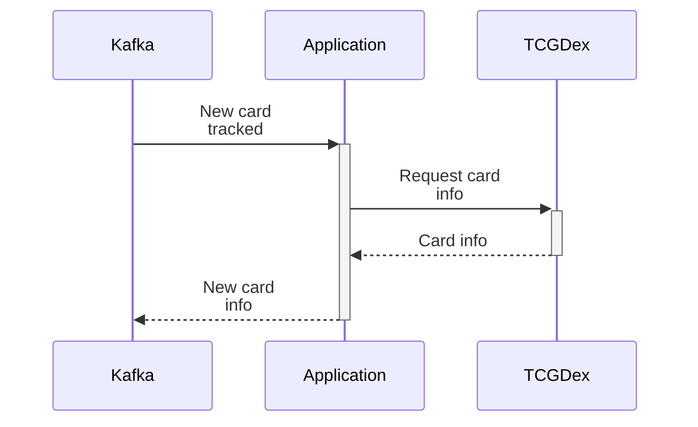
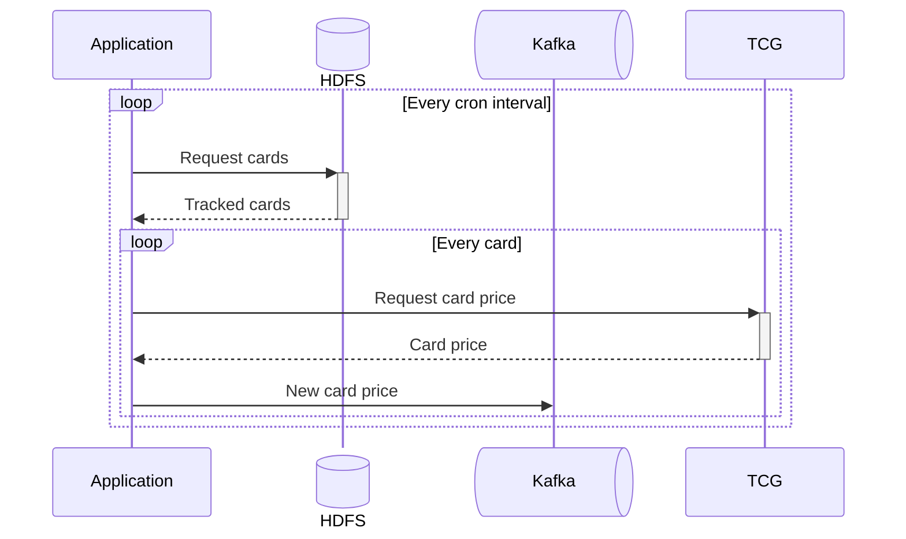

# Requirements
Listen to kafka topic, when receiving anything, react to this.
 - Fetch the new pokemon card (potentially historical data)

Run a cron job, where whenever the cron schedule lines up, fetch all tracked cards.  
Push this to a kafka topic.

## Jobs
### New card tracked

### Cron job

## To run
to run this locally, you can't be using minikube or a kubernetes cluster.

A requirement because of dns resolution is to run this locally.

1. Download kafka zip
1. cd into the extracted zip
1. `bin/kafka-storage.sh format --standalone -t em80bi2zT0q39Jx0w9xI3w -c config/server.properties`
2. `bin/kafka-server-start.sh config/server.properties`
1. Extra
	1. Create the topic first `bin/kafka-topics.sh --bootstrap-server localhost:9092 --topic {TOPIC} --create`
	1. Produce is `bin/kafka-console-producer.sh --bootstrap-server localhost:9092 --topic {TOPIC}`
	1. Consume is `bin/kafka-console-consumer.sh --bootstrap-server localhost:9092 --topic {TOPIC}`