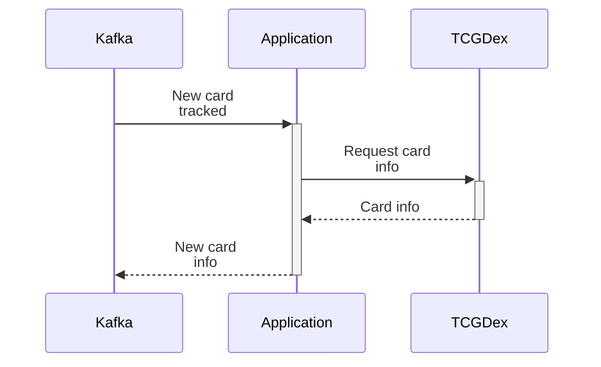
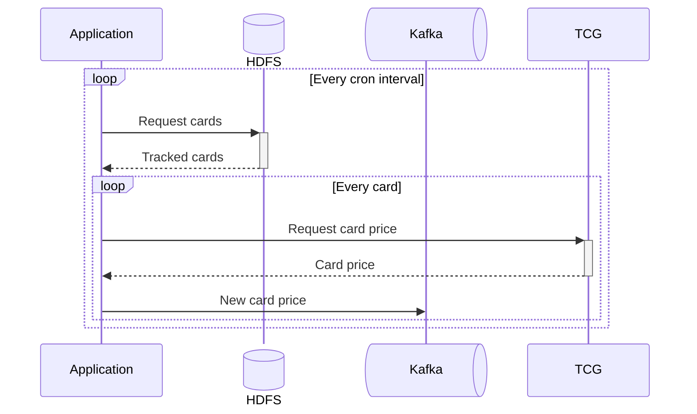

# Requirements
Listen to kafka topic, when receiving anything, react to this.
 - Fetch the new pokemon card (potentially historical data)

Run a cron job, where whenever the cron schedule lines up, fetch all tracked cards.  
Push this to a kafka topic.

## Jobs
### New card tracked

### Cron job
